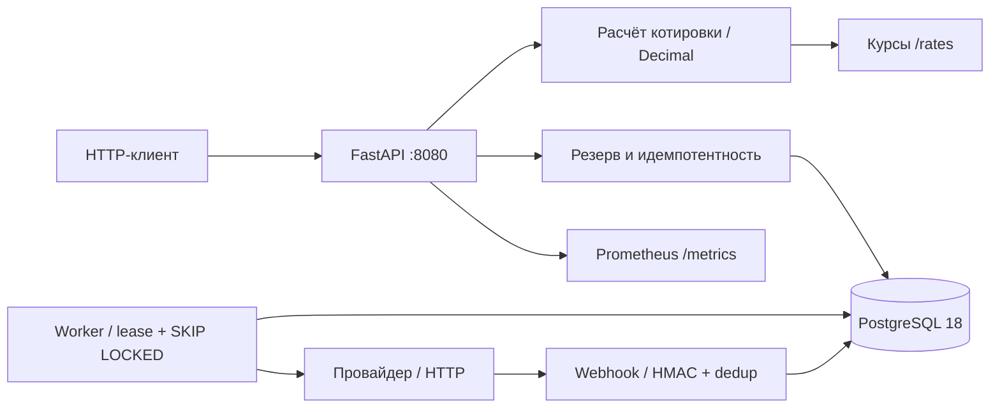

# Архитектура

Расчёт, выбор провайдера, транзакции и HTTP-адаптер разделены по модулям.
Котировка хранит цену и FX-снимок. Создание перевода атомарно резервирует деньги и сохраняет
задание worker. Внешний HTTP выполняется после коммита попытки со стабильным ключом.

Worker подтверждает результат через GET провайдера. Webhook ускоряет сверку. Наблюдения
сохраняются в attempt_observations; неподтверждённый исход не освобождает резерв.
Терминальное завершение и изменение баланса происходят в одной транзакции.
