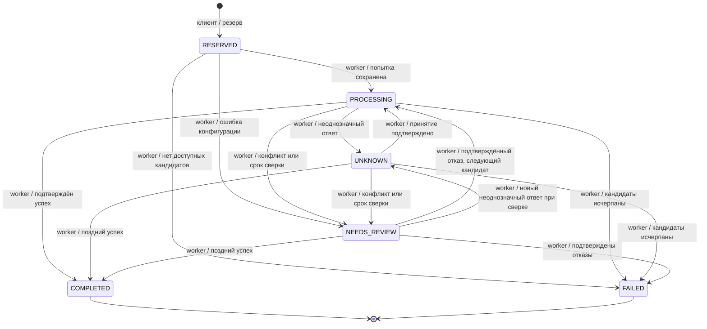

# Решения

## Исполнение

FastAPI реализует HTTP-контракт и валидацию. Расчёт и ранжирование - чистые функции.
Долговечная очередь хранится в PostgreSQL: next_run, lease_owner, lease_until.
POST /transfers атомарно резервирует деньги и создаёт задачу, затем возвращает 202.
При ответе провайдера через 30 секунд клиент видит PROCESSING/UNKNOWN, деньги остаются в held.

## State machine



Webhook ускоряет сверку, но не выполняет финансовый расчёт сам. Изменения статуса проходят
через transition. Отказ отдельной попытки не означает отказ всего перевода.

## Транзакции

Создание: FOR UPDATE клиента -> проверка ключа -> FOR UPDATE котировки -> одноразовость и TTL ->
проверка средств/суточного лимита/маршрута -> available в held -> перевод. Коммит общий.
UNIQUE страхует client/key и quote_id. Завершение блокирует клиент -> перевод -> счёт.
Успех переносит held в spent, отказ возвращает held в available и освобождает лимит дня создания.
CHECK запрещает отрицательные остатки и нарушение available + held + spent = initial.

Worker использует SKIP LOCKED. Lease выдаётся на 20 секунд; HTTP-таймаут - 3 секунды.
Попытка и её UUID/reference/provider key сохраняются до HTTP. Сеть не удерживает транзакцию.
После падения следующий worker сначала проверяет прежний reference. Устаревший владелец lease
не может применить результат. Повторный POST использует тот же ключ у того же провайдера.

5xx и 404 не доказывают отсутствие выплаты. Переключение разрешено после явного 422 или
подтверждённого FAILED; FAILED из GET проверяется повторно. Подписанный COMPLETED при FAILED
из GET и смена payout_id переводят операцию в NEEDS_REVIEW. Наблюдения сохраняются отдельно
от текущего статуса попытки. При затяжной неопределённости причина доступна в review_reason.
Сверка продолжается с увеличенной задержкой; поздний достоверный успех завершает перевод.

Адаптер starter также распознаёт отказ самого первого POST: точный ответ HTTP 500
INTERNAL_ERROR / internal provider error в его исходниках возвращается до создания выплаты.
Этот результат разрешает следующий кандидат. Повторная отправка после неоднозначности такой
гарантии не даёт: даже INTERNAL_ERROR может относиться к уже существующей выплате.
Остальные протоколы используют консервативную обработку PROVIDER_PROTOCOL=conservative.

## Ранжирование

Сначала направление, enabled, maintenance [from,to), FX для валюты провайдера, лимиты principal
и минимальная маржа. Затем минимизируется:

```text
0.50 * provider_fee_in_source / source_amount
+ 0.35 * (1 - success_rate_24h)
+ 0.15 * p95_latency_ms / 30000
```

При равенстве - provider_id. Фиксированные шкалы делают оценку независимой от других кандидатов.
Маржа обязательна и для запасного. План хранит кандидатов, причины исключения, оценки и версию
конфигурации. Перед каждой новой попыткой заново проверяются все фильтры, включая стоимость и
маржу. Уже опробованные провайдеры исключаются, снимок решения сохраняется в selections.

## Наблюдаемость

API и worker пишут JSON с transfer_id; HTTP также содержит request_id и duration_ms.
Prometheus-метрики строятся по PostgreSQL, поэтому переживают рестарт процессов.
Нагрузочный сценарий измеряет задержки и throughput, затем сверяет фактические выплаты и баланс.
Отдельный Prometheus в Compose хранит временные ряды 7 дней. Счётчики статусов имеют нулевые
значения до первого перевода; остатки доступны в minor units с метками клиента, валюты и вида остатка.
Демонстрационный прогон создаёт операции через публичный API и проверяет их появление в TSDB.

## Использование ИИ

OpenAI Codex использован для разбора требований, проектирования, реализации, тестов и документации.
В ходе проверки исправлены: определение следующего кандидата через число попыток вместо его номера;
небезопасный failover по 5xx+404; смешение 5xx при отправке и сверке; приоритет ошибок использованной
и истёкшей котировки; недоступный IPv6 localhost; права на файл coverage внутри контейнера.
Ошибки обнаружены интеграционными тестами, сквозными прогонами и проверкой сетевого подключения.

После получения starter демонстрационный эмулятор заменён официальным. Все исходные файлы
data/, examples/, mock-provider/ и chaos_run.py сохранены без изменений и проверяются SHA-256.
Отсутствие подходящих провайдеров стало итоговым FAILED, а не ошибкой создания перевода.
Повторная проверка обнаружила использование времени начала HTTP-запроса для TTL после ожидания
FOR UPDATE. Время перенесено за блокировки; регрессионный тест с реальным ожиданием PostgreSQL
подтверждает QUOTE_EXPIRED без резерва. Официальный chaos и crash-проверка вынесены в отдельный
Compose-проект, чтобы проверочные перезапуски не затрагивали демонстрационные операции.
