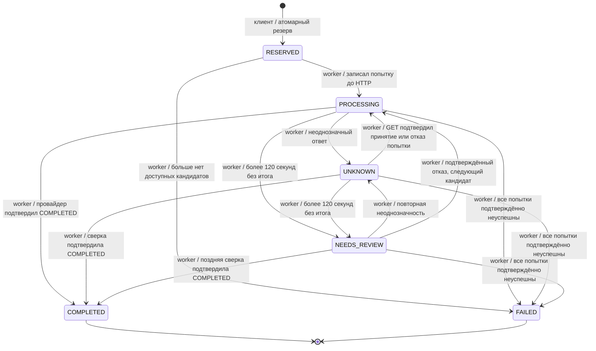

# Решения

## Компоненты

FastAPI отвечает за HTTP и валидацию. Расчёт и ранжирование - чистые функции.
SQLAlchemy отвечает за транзакции PostgreSQL; Alembic - за миграции. Redis/Celery не нужны:
сам перевод является долговечной задачей с `next_run`, `lease_owner`, `lease_until`.

POST /transfers завершает только локальную транзакцию резерва и отвечает 202. Если провайдер
думает 30 секунд, клиент видит PROCESSING/UNKNOWN через GET, деньги остаются в резерве.
HTTP-таймаут worker - 3 секунды, опрос - каждые 2 секунды. Неопределённость более 120 секунд
обозначается NEEDS_REVIEW; без подтверждения деньги не освобождаются.

## State machine



Webhook провайдера только ускоряет сверку. Переходы проверяются одной функцией `transition`.
Повтор того же статуса не добавляет историю. Отказ отдельного провайдера отражается в attempts,
а перевод остаётся PROCESSING, пока возможен следующий кандидат.

## Транзакции и конкуренция

Создание: блокировка клиента FOR UPDATE -> проверка ключа -> блокировка котировки -> проверка
одноразовости и TTL -> проверка средств/лимита/маршрута -> перенос available в held -> запись
перевода. Коммит общий: нет окна между резервом и постановкой задачи. Ограничения UNIQUE
страхуют client/key и quote_id. Два запроса к одному клиенту сериализуются; запросы разных
клиентов могут выполняться параллельно.

Завершение: клиент -> перевод -> счёт, всё в одной транзакции. COMPLETED переносит held в spent,
FAILED возвращает held в available и освобождает расход суточного лимита. CHECK в БД запрещает
отрицательные остатки и нарушение `available + held + spent = initial`.

Worker забирает работу через FOR UPDATE SKIP LOCKED, коммитит lease, затем коммитит новую
попытку со стабильным UUID/reference/ключом и только после этого делает HTTP. Сетевой вызов
не удерживает транзакцию БД. После падения lease истечёт через 20 секунд; другой worker найдёт
ту же попытку и сначала сделает GET. Повторный POST всегда использует прежний ключ этой попытки.
Результат устаревшего владельца lease не меняет перевод. Нужна идемпотентность со стороны провайдера.

## Выбор провайдера

Сначала направление, enabled, maintenance [from,to), лимиты principal и минимальная маржа.
Затем минимизируется:

```text
0.50 * (provider_fee_in_source / source_amount)
+ 0.35 * (1 - success_rate_24h)
+ 0.15 * (p95_latency_ms / 30000)
```

При равенстве - provider_id. Фиксированные шкалы позволяют объяснить оценку независимо от состава
других кандидатов. Вес цены больше остальных, но надёжность и задержка могут перевесить небольшую
экономию. Это эвристика, а не оптимум ожидаемой прибыли: без цены отказа и бизнес-SLA точнее
обосновать веса нельзя. Запасной ниже минимальной маржи не допускается.

План сохраняется вместе с переводом и доступен через /routing. Новый конфиг применяется к новым
переводам; enabled и maintenance повторно читаются перед новой попыткой уже существующего
перевода. Отключение провайдера не мешает узнать исход ранее принятой им выплаты.

## Надёжность и границы гарантий

Нет обещания exactly-once через одну нашу БД: оно опирается на идемпотентность и достоверный GET
провайдера. Неопределённый исход оставляет деньги в held и не запускает следующего провайдера.
Исключение для полного 5xx с авторитетным 404 описано в ASSUMPTIONS.md, пункт 14.
Противоречащие терминальные ответы провайдера не разрешаются автоматически - см. LIMITS.md.

Webhook дедуплицируется по (provider_id,event_id). Подпись проверяется по исходным байтам HMAC
с constant-time compare. Дубли и поздние события безопасны, потому что финансовое действие
выполняется только по результату GET в общей транзакции завершения.

## Использование ИИ

Решение подготовлено с помощью OpenAI Codex: разбор PDF, проектирование, код, тесты,
демонстрационный эмулятор и документация. Это существенная помощь ИИ, а не только автодополнение.
Внешние сообщения и сдача задания по почте автоматически не выполнялись.

Замеченные ошибки в ходе работы:

- Первоначальный worker определял следующий индекс через количество попыток. После пропуска
  отключённого кандидата это могло вернуть его к уже выбранной позиции. Исправлено: используется
  номер последней попытки. Добавлена регрессионная проверка пропуска кандидата.
- Сначала не различались 5xx от POST и 5xx при сверке. Это могло ошибочно разрешить failover
  после неоднозначного исхода. Добавлены отдельные результаты и сохраняемый флаг uncertain,
  который запрещает считать 404 доказательством отказа такой попытки.
- Один тест ожидал QUOTE_ALREADY_USED, а код сначала возвращал QUOTE_EXPIRED. Тест обнаружил
  разную трактовку приоритета ошибок; порядок проверок согласован и описан.
- В локальном запуске localhost сначала выбирал IPv6, при том что проброшен IPv4-порт Docker.
  Подключение зависало. Проверка прямого IPv4-соединения выявила причину; локальные адреса БД
  заменены на 127.0.0.1, добавлен connect_timeout.

Перед защитой нужно самостоятельно пройти DEFENSE.md и уметь изменить код. Документация
не утверждает, что кандидат уже изучил или независимо написал каждую часть реализации.
